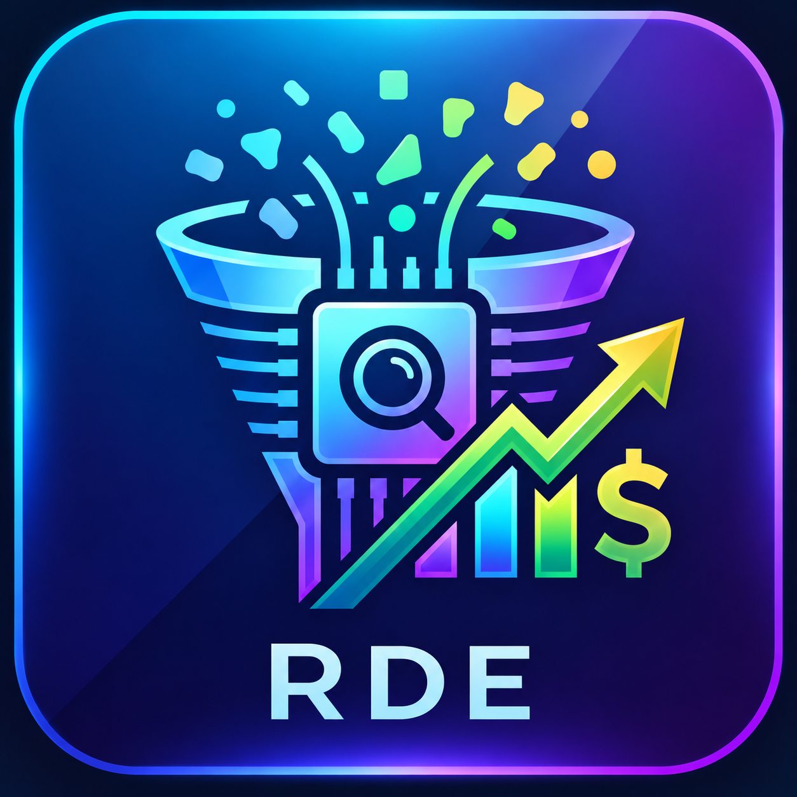
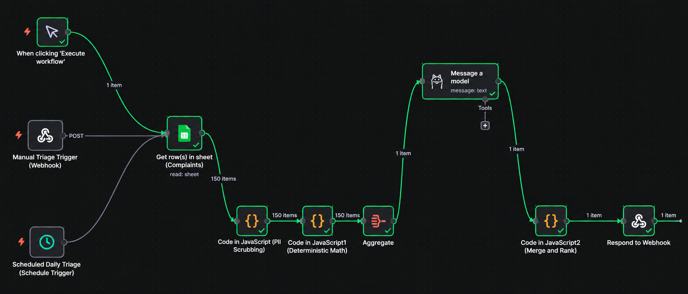

<h1 align="center">Revenue Discovery Engine for Amazon PMs</h1>

<p align="center">
  
  &nbsp;&nbsp;&nbsp;
  
</p>

An AI-powered product discovery tool for Amazon PMs that identifies customer pain points, estimates potential revenue at risk, and ranks product opportunities by business impact rather than complaint volume.

<p align="center">
  <a href="https://revenue-discovery.lovable.app">View Live Project</a>
</p>

## The Problem

Product teams receive customer feedback from multiple sources, but complaint volume alone does not reveal which problems matter most to the business.

Without a consistent way to connect customer pain points to conversion and revenue impact, prioritization can become reactive. High-impact issues may be overlooked, while teams spend significant time manually analyzing feedback across support systems, analytics tools, and spreadsheets.

**The opportunity:** Help product managers identify which problems to solve first by combining customer insights, root-cause analysis, and estimated business impact.

## What It Does

Revenue Discovery Engine transforms customer feedback into a revenue-weighted view of product opportunities.

1. **Customer feedback ingestion:** Reads customer complaints and support ticket data.
2. **PII masking:** Masks personal information before customer text is processed by the language model.
3. **Revenue impact estimation:** Calculates revenue at risk using deterministic logic based on traffic, conversion drop, and average order value.
4. **Root-cause analysis:** Groups related complaints into themes using Llama 3 through Ollama.
5. **Revenue-weighted prioritization:** Ranks problem themes by estimated revenue at risk rather than complaint volume alone.
6. **Evidence-backed decisions:** Displays calculations, customer quotes, and conversion charts to explain each priority.
7. **Backlog refinement:** Generates Jira-ready drafts containing a summary, business value, and description.

## Product Management Principles

- **Prioritize impact over volume:** Evaluate customer problems by their estimated business impact, not just how often they are reported.
- **Keep calculations deterministic:** Compute revenue estimates in application code so the logic remains transparent and traceable.
- **Use AI for synthesis, not arithmetic:** Use the LLM to identify recurring themes without relying on it to generate revenue figures.
- **Make decisions evidence-based:** Present supporting calculations and customer feedback so stakeholders can inspect the rationale behind each priority.
- **Connect discovery to execution:** Translate identified opportunities into structured drafts that support backlog refinement and stakeholder alignment.

## Data Sources and Integrations

- **Zendesk:** Reads exported ticket data in Zendesk's JSON format. This is file-based ingestion, not a live Zendesk API integration.
- **Google Sheets:** Serves as the working data source in the current n8n workflow.
- **Mixpanel:** Planned integration for product usage and conversion data. Traffic and conversion figures currently rely on sample values.

## Architecture

**Workflow orchestration**

Manual trigger / webhook / daily schedule → Google Sheets → PII masking → deterministic revenue calculation → aggregation → Ollama (Llama 3) theme classification → merge and rank → webhook response.

The workflow separates deterministic business calculations from AI-assisted complaint classification, keeping revenue calculation logic independent of model-generated text.

## Key Product Metrics

The following metrics can help evaluate whether the tool improves product decision-making:

- **Prioritization quality:** How closely revenue-weighted rankings align with expert-reviewed business impact.
- **Classification quality:** Precision and recall of root-cause themes against human-labelled complaints.
- **Time to insight:** Time required to turn raw customer feedback into prioritized opportunities.
- **Decision traceability:** Whether each priority has inspectable calculations and supporting customer evidence.
- **Actionability:** Whether prioritized opportunities lead to documented product decisions or backlog items.

These are proposed evaluation metrics, not measured outcomes.

## Design and Privacy Considerations

- **Local model execution:** Llama 3 runs through Ollama, keeping customer text on the machine during model processing.
- **PII masking:** Personal information is masked before model processing. Masking effectiveness still requires validation.
- **Transparent calculations:** Revenue estimates are computed in code rather than generated by the LLM.
- **Human review:** Revenue estimates and AI-generated themes should be reviewed before informing significant business decisions.
- **Production readiness:** Production deployment would require further validation of data quality, access controls, privacy protections, and model performance.

## Tech Stack

- **Frontend:** React, TypeScript, Vite, Tailwind CSS
- **AI and NLP:** Llama 3, Ollama
- **Workflow orchestration:** n8n
- **Data source:** Google Sheets
- **Integrations:** Webhooks, with Zendesk and Mixpanel planned

## Running Locally

```bash
npm install
npm run dev -- --port 3000
```

Open the local address printed by the development server.

To connect a running n8n webhook, configure `VITE_N8N_WEBHOOK_URL` in `.env.local`. Without it, the dashboard uses its built-in sample data.

## Current Limitations

- Event tracking is stored locally in the browser and is not sent to an analytics service.
- Theme clustering has not yet been evaluated against human-labelled complaints.
- Zendesk API connectivity and Mixpanel integration are not implemented.
- Traffic and conversion figures currently include sample values.
- Jira handoff generates copy-ready text rather than creating issues through the Jira API.
- Lint reports issues in shadcn UI components and the Tailwind configuration.

## Roadmap

1. Integrate Zendesk and Mixpanel as live data sources.
2. Evaluate root-cause classification against human-labelled complaints using precision and recall.
3. Validate estimated revenue impact against observed business outcomes.
4. Add Slack summaries and Jira API integration.
5. Introduce a regression dataset of historical incidents to track improvements over time.

---

<p align="center">
  <strong>Understand customer friction. Quantify business impact. Prioritize what matters most.</strong>
</p>
